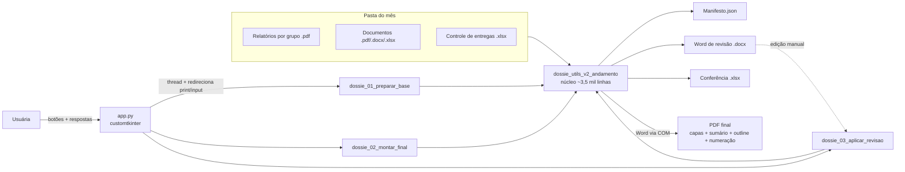

# Gerador de Dossiês

> **Summary in English.** Desktop app (Python + customtkinter, packaged with PyInstaller) that assembles the monthly
> compliance dossier of an infrastructure-management program. It scans a month folder full of deliverables
> (PDFs, Word/Excel files, a delivery-control spreadsheet), infers which group/product each file belongs to,
> builds an editable Word review draft with a structured table of contents, lets a human fix titles and drop in
> missing PDFs, and then produces the final PDF with covers, clickable TOC, bookmarks and page numbers — plus an
> Excel checklist of everything that is still missing. Built by Emmily Maciel in a real engineering-consulting
> context; this public copy is sanitized and runs on fictitious data.

## Problema

Todo mês, o programa precisa entregar um **dossiê** que junta dezenas de documentos técnicos (notas técnicas,
pareceres, relatórios de inspeção, atas) produzidos por cinco grupos de trabalho, cada um com seus produtos
(`P1.1`, `P2.3`…). Montar isso à mão significava: abrir pasta por pasta, descobrir a que produto cada arquivo
pertence, converter Word em PDF, criar capas, montar sumário, numerar páginas e conferir contra a planilha de
controle de entregas o que faltou. Trabalho repetitivo, lento e propenso a esquecer documento.

## Solução

Um aplicativo com três botões, um para cada fase, e um "assistente" (mascote) que conversa com a usuária num
console embutido:

1. **Criação Base** — varre a pasta do mês, classifica cada arquivo por grupo/produto (pelo nome, pela pasta ou
   pelo texto do PDF), copia os anexos para `Anexos - Revisão/<grupo>/<produto>/`, gera o **Word de revisão**
   (sumário estruturado), um **PDF de revisão**, o `Manifesto.json` e a **planilha de conferência**.
2. **Gerar Revisão** — relê o Word que a usuária editou, absorve PDFs que ela colocou manualmente nas subpastas e
   gera DOCX + PDF finais.
3. **Gerar Final Direto** — monta o final sem revisão manual.

O PDF final sai com capas (modelo Word opcional ou capa desenhada pelo código), sumário clicável, marcadores
(outline) e numeração aplicada uma única vez no fim. A planilha lista o que está sem PDF, o que consta no controle
de entregas mas não foi localizado e a página-base de cada item.

## Arquitetura



Decisões de desenho visíveis no código:

- **Reuso sem reescrita:** a GUI não reimplementa nada — importa os três scripts de linha de comando e chama
  `main()` numa thread, trocando `print`/`input` por um console e uma fila (`queue.Queue`). Os scripts continuam
  rodando sozinhos pelo terminal.
- **Manifesto como estado entre fases:** a fase 1 grava `Manifesto.json`; as fases 2 e 3 só leem o manifesto
  e a pasta `Anexos - Revisão`, então a revisão humana fica no meio do fluxo sem perder rastreabilidade.
- **Classificação em camadas:** pasta do produto → pasta do grupo → código no nome do arquivo → texto do PDF.
- **Degradação graciosa:** sem modelos de capa, sem imagens do mascote ou sem relatório do grupo, o app segue
  com capas desenhadas em Pillow e títulos de produto padrão.

## Números

| Indicador | Valor | Fonte |
|---|---|---|
| Código Python | ~4,7 mil linhas (núcleo: ~3,5 mil, 131 funções) | contagem no código desta versão |
| Fases do fluxo | 3 (base, final direto, revisão) | código |
| Executável empacotado | ~107 MB | `docs/STATE.md` |
| Testes automatizados | nenhum (smoke = `py_compile`) | `docs/STATE.md` |
| Dossiês gerados / tempo economizado por mês | `[a confirmar pela autora]` | — |

## Como rodar (dados fictícios)

Requer **Windows com Microsoft Word** (a conversão DOCX → PDF usa Word via COM/`pywin32`) e Python 3.12+.

```bat
py -m pip install -r requirements.txt

:: 1) cria examples\produtos\01. Janeiro 2026\ com PDFs, um .docx e uma planilha de controle inventados
py examples\gerar_exemplo.py

:: 2) abre o app (ou: iniciar.bat)
py app.py
```

No app, clique em **1. Criação Base** e responda `1` quando ele perguntar o mês. A saída vai para `saida\`.
Também dá para rodar só pelo terminal:

```bat
py dossie_01_preparar_base.py --month-root "examples\produtos\01. Janeiro 2026"
py dossie_02_montar_final.py  --month-root "examples\produtos\01. Janeiro 2026"
```

Variáveis opcionais: `DOSSIE_MONTHS_DIR` (pasta com as pastas de mês) e `DOSSIE_OUTPUT_DIR` (saída).
Modelos de capa em Word são opcionais — ver [`CAPAS/README.md`](CAPAS/README.md).

> Atenção: a fase 1 **apaga e recria** a pasta do mês na saída, a menos que receba `--no-clean`.

Executável (opcional): `pyinstaller app.spec`.

## O que eu decidi × o que a IA gerou

| Eu (Emmily) decidi | Gerado com apoio de IA (Claude Code / Codex), sob minha revisão |
|---|---|
| Que o dossiê seria montado em **três fases** com revisão humana no meio (Word editável antes do PDF final) | Implementação das funções de descoberta, cópia e manifesto |
| A estrutura de saída: `Anexos - Revisão/<grupo>/<produto>/`, manifesto JSON e planilha de conferência | Composição do PDF com PyMuPDF (sumário, links, outline, numeração) |
| Que a planilha de conferência deveria cruzar arquivos encontrados × controle de entregas × sumário | Renderização de capas com Pillow e substituição de placeholders nos modelos Word |
| Uma GUI com mascote e console de conversa para usuárias não técnicas, reaproveitando os scripts existentes | Redirecionamento de `print`/`input` para a GUI e execução em thread |
| Modelos Word de capa (autoria declarada no projeto privado; substituídos por capas genéricas nesta versão) | Ajustes de robustez (caminhos longos no Windows, sessão do Word, fallbacks) |

Base: histórico do projeto (`docs/STATE.md`) e o README de trabalho
([`docs/README-original-sanitizado.md`](docs/README-original-sanitizado.md)). A divisão fina por arquivo
`[a confirmar pela autora]`.

## Stack

Python · customtkinter · Pillow · python-docx · PyMuPDF · pypdf · openpyxl · pywin32 (Word COM) · PyInstaller

## Verificação, sanitização e licença

- **Testes:** sem suíte automatizada; execução ponta a ponta com os dados fictícios conferida em 17/11/2026 (passos em "Como rodar").
- **Dados:** fictícios — cópia sanitizada de um sistema em uso real; nenhum dado de cliente ou de terceiro.
- **Sanitização:** o que foi removido, trocado ou inventado nesta cópia está em [`SANITIZACAO.md`](SANITIZACAO.md).
- **Licença:** todos os direitos reservados; leitura permitida para avaliação de portfólio — ver [`LICENSE`](LICENSE) e [`NOTICE`](NOTICE).

## Aviso

*Dados fictícios. Versão sanitizada de um sistema em uso real; identificadores do cliente foram substituídos.*
Códigos de grupo/produto, títulos, mascote, ícone e modelos de capa desta cópia são genéricos.

Autora: **Emmily Maciel** — [github.com/Emmilymaciell](https://github.com/Emmilymaciell)
